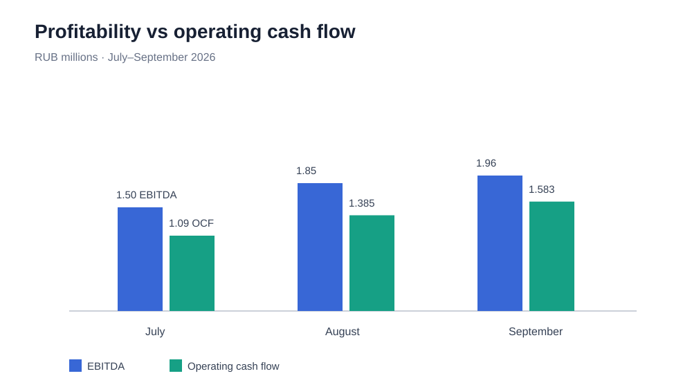
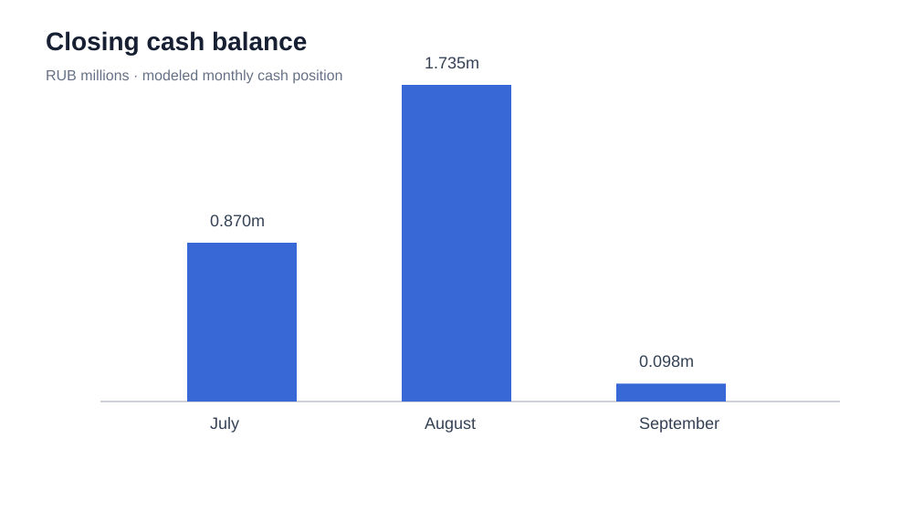
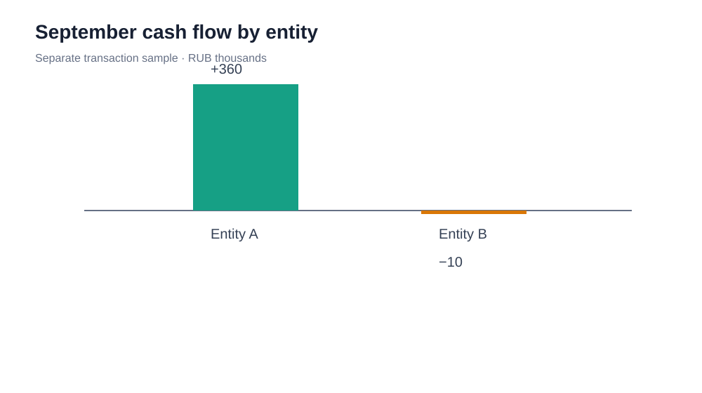

# Financial Management & Cash Flow Analysis

A portfolio case demonstrating **management reporting, cash-flow analysis, working-capital awareness, and financial model design** for an anonymized wholesale/e-commerce business.

> **Data note:** This repository contains illustrative, anonymized data based on an assessment case. It does not contain the original workbook or source PDF, real customer records, or identifiable company information. Currency: RUB.

## Business question

How can a business report positive accounting profit while experiencing a significant decline in available cash?

The project combines three analytical views:

1. A three-month accrual P&L and direct cash-flow model.
2. A profit-to-cash bridge explaining timing differences and investment/financing outflows.
3. A September cash-flow review across two legal entities, with internal transfers excluded from consolidated cash flow.

## Key findings

- September net profit in the monthly model is RUB 1.352m and operating cash flow is RUB 1.583m.
- After RUB 2.0m of CAPEX and financing outflows, the modeled net change in cash is negative RUB 1.637m.
- The separate September transaction sample produces RUB 350,000 net cash flow after excluding a RUB 200,000 internal transfer.
- Entity A contributes +RUB 360,000 and Entity B −RUB 10,000 in the transaction sample.
- The transaction sample has no opening balance, so its closing cash balance is not inferred.

**Important:** The monthly model and September transaction sample are separate illustrative datasets. They must not be combined into one reconciled ledger.

## Reports / Отчёты

- [English case study](docs/financial_management_case_study.md)
- [Русская версия кейса](docs/financial_management_case_study_ru.md)

## Visual analysis

### Profitability versus cash flow



### Closing cash balance



### Cash flow by legal entity



### Case study cover


## Repository structure

```text
.
├── analysis.py
├── data/
│   ├── monthly_inputs.csv
│   └── cash_transactions_september.csv
├── docs/
│   ├── methodology.md
│   └── financial_management_case_study.md
├── images/
│   ├── cover.svg
│   ├── profit-vs-cash-flow.svg
│   ├── closing-cash-balance.svg
│   └── entity-cash-flow.svg
├── outputs/
│   ├── monthly_model.csv
│   ├── september_cash_flow_by_category.csv
│   ├── september_cash_flow_by_entity.csv
│   └── september_control_checks.json
└── requirements.txt
```

## Tools

- Python
- pandas
- CSV-based financial data modeling
- Reconciliation and control checks
- SVG for reproducible, scalable visual reporting

## How to run

```bash
python -m pip install -r requirements.txt
python analysis.py
```

The script rebuilds the output files in `outputs/`.

## Analytical approach

- Separate accrual-based profitability from cash movement.
- Model collections and supplier payments using explicit timing assumptions.
- Classify cash flows into operating, investing, and financing activities.
- Exclude internal transfers from consolidated cash flow.
- Review cash flow by legal entity and on a consolidated basis.
- Make missing inputs and model limitations explicit instead of inventing balances.

See [Methodology and assumptions](docs/methodology.md) and the [case study report](docs/financial_management_case_study.md).

## Portfolio positioning

This project demonstrates the ability to structure a management reporting model, analyze liquidity, classify transactions, identify missing financial inputs, and communicate findings in business terms.

It is an illustrative portfolio case, not an audit opinion, statutory financial statement, or production-ready treasury model.
